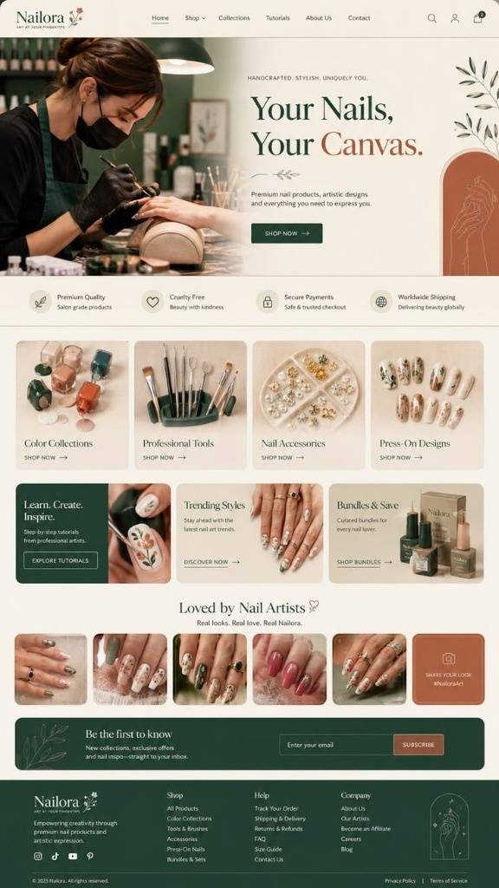

# 💅 Nailora — Art At Your Fingertips

A luxury, high-conversion e-commerce and portfolio web application for **Nailora**, crafted with handcrafted aesthetics, salon-grade formulations, and seamless mobile responsiveness across all devices (smartphones, tablets, laptops, and desktops).



---

## ✨ Features & Architecture

### 🎨 Visual Identity & Theme
- **Color Palette**: Warm Linen Cream (`#FAF7F2`), Deep Forest Green (`#1E3B30`), Terracotta / Burnt Sienna (`#AF5C40`), and Warm Clay Card backgrounds (`#EDE4D6`).
- **Typography**: Editorial serif headings (`Playfair Display`, `Cormorant Garamond`) paired with crisp modern typography (`Plus Jakarta Sans`).
- **Custom Floral Sprig & Arched Vector Artwork**: Custom scalable SVG icons for the Nailora blossom, olive botanical sprigs, and terracotta hand art arches.

### 📜 Scroll Effects & Smooth Animations (Inspired by Noor Project)
- **Sticky Glassmorphism Header**: Transitions smoothly from transparent linen to `bg-cream-50/95 backdrop-blur-md shadow-sm border-b` on scroll.
- **Top 2.5px Scroll Progress Bar**: Sleek terracotta progress indicator tracking page scroll percentage.
- **Active Section Spy**: Highlights navigation links with an animated underline indicator as sections enter the viewport.
- **Framer Motion Reveals**: Staggered fade and slide-up animations (`whileInView`) on all cards, heroes, and trust pillars.
- **Subtle Themed Scrollbar**: Custom cream track with terracotta hover thumb.

### 📱 100% Mobile Responsive
- Optimized for all screen sizes: **320px, 360px, 375px (iPhone SE), 390px, 414px, 640px, 768px, 1024px+**.
- Full-width mobile sliding drawer navigation with quick search and VIP member access.
- Flexible split and bento cards that adapt without text clipping or horizontal overflow.
- Mobile-friendly touch targets (min 44px) and adaptive typography.

### 🛍️ Interactive E-Commerce & Modals
- **Interactive Slide-Over Bag / Cart**:
  - Pre-loaded with 2 items matching the reference image's bag count badge.
  - Quantity controls (`+` / `-`), item removal, and subtotal calculation.
  - Dynamic **Free Shipping Progress Bar** ($50 threshold).
  - Promo code discounts (e.g. `NAILORA15` for 15% VIP discount, `CANVAS` for 20% discount).
  - Checkout simulator with celebratory **confetti animation**!
- **Featured Salon Formulations**:
  - Filter pills (*All*, *Color Collections*, *Tools*, *Accessories*, *Press-Ons*).
  - Star ratings, shade color swatches, and "Add to Bag".
- **Quick View Modal**: Inspect shades, application finishes (*High Gloss*, *Velvet Matte*, *Cat-Eye*), and volume specs.
- **Masterclass Academy Modal**: Step-by-step video preview and technique breakdown by senior salon artisans.
- **Loved by Nail Artists ♡ UGC Community**:
  - 5 Real customer manicures with artist credits, like counts, and **"Shop This Look"** action.
  - 6th Terracotta Card: **`SHARE YOUR LOOK #NailoraArt`** with photo upload and Instagram handle submission.
- **Live Search Modal**: Real-time search across shades, brushes, charms, and tutorials.
- **VIP Atelier Account Drawer**: Member tier status, rewards points balance, and order tracker.
- **Floating VIP Concierge (WhatsApp) Button**: Instant 1-on-1 shade consultation with live concierge popover.

---

## 🚀 Getting Started

### Prerequisites
- [Node.js](https://nodejs.org/) (v18 or higher recommended)
- npm or pnpm or yarn

### Installation
```bash
# Clone the repository
git clone https://github.com/rajdixit070-v/nailora.git

# Navigate to project directory
cd nailora

# Install dependencies
npm install

# Start local development server
npm run dev
```

Visit **http://localhost:5173** to view the application live.

### Production Build
```bash
# Build optimized production bundle
npm run build

# Preview production build locally
npm run preview
```

---

## 🛠️ Tech Stack
- **Framework**: [React 19](https://react.dev/) + [Vite](https://vitejs.dev/)
- **Styling**: [Tailwind CSS](https://tailwindcss.com/)
- **Animations**: [Framer Motion](https://www.framer.com/motion/)
- **Icons**: [Lucide React](https://lucide.dev/) + Custom Scalable SVGs
- **Celebration Effects**: [Canvas Confetti](https://www.kirilv.com/canvas-confetti/)

---

## 📄 License
This project is proprietary and handcrafted for Nailora. All rights reserved © 2025.
